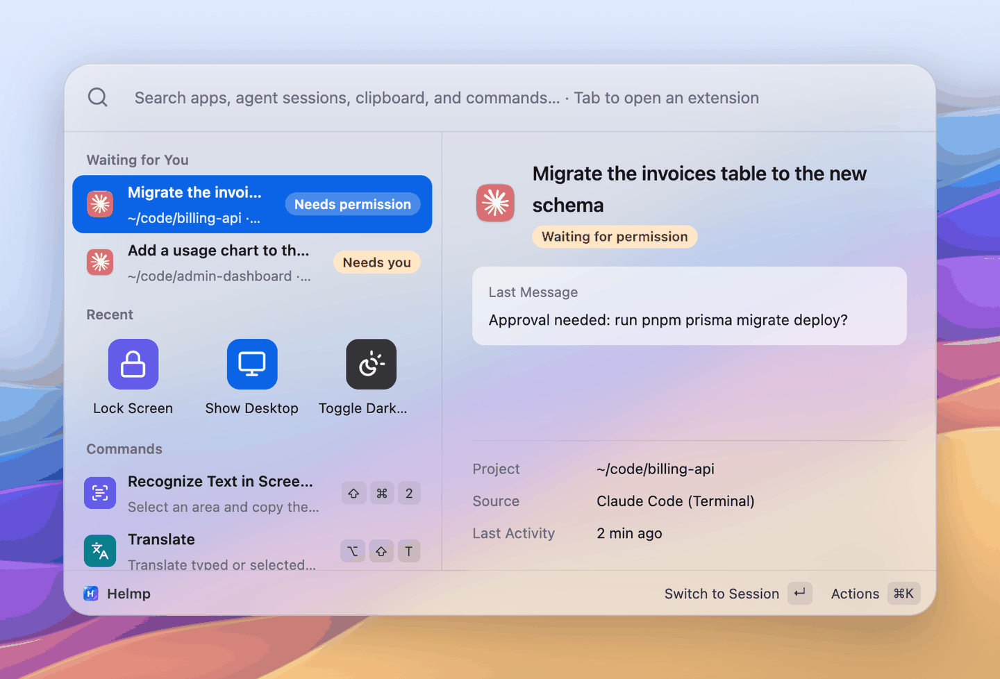
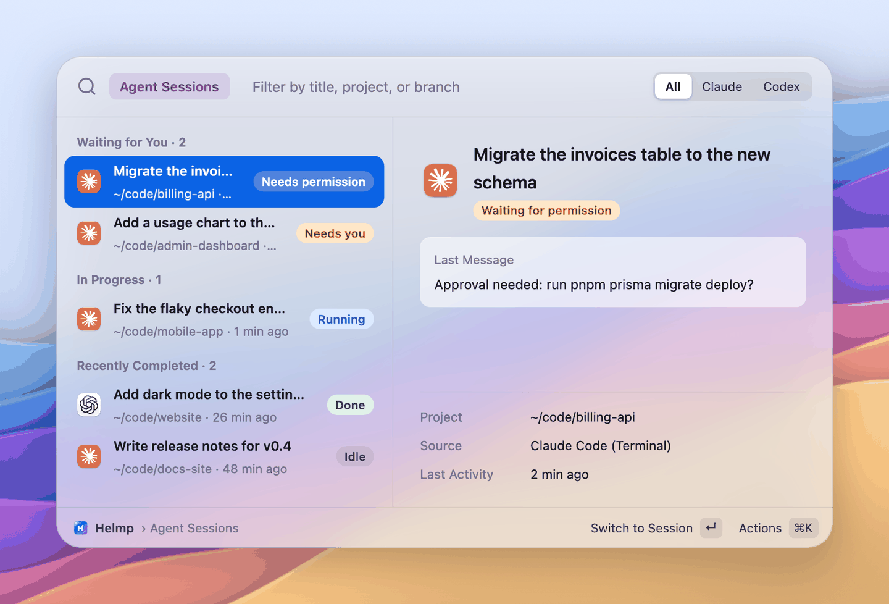
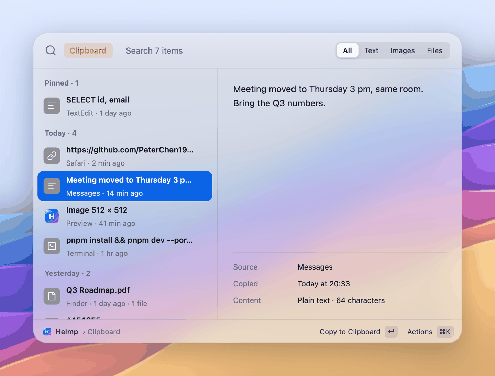
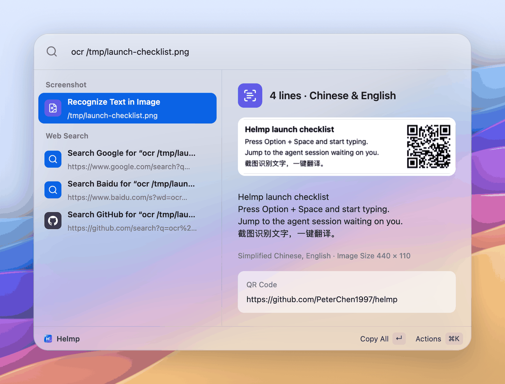
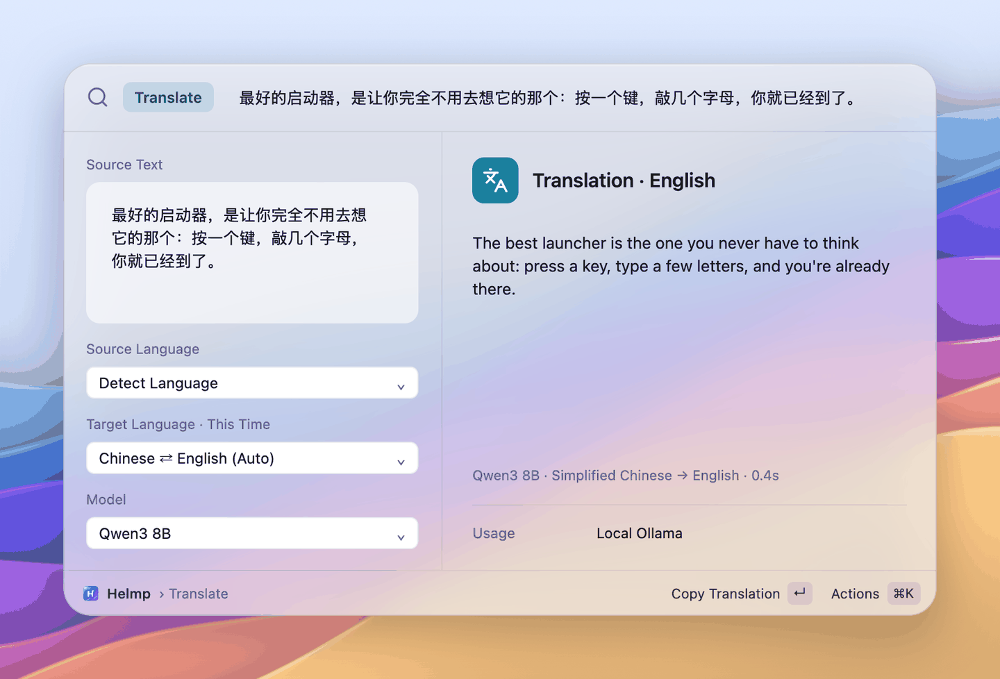

<p align="center">
  
</p>

<h1 align="center">Helmp</h1>

<p align="center">
  A native macOS launcher that also tells you which coding agent is waiting for you.<br>
  Written in Rust with GPUI. Local-first, no account, no telemetry.
</p>

<p align="center">
  English · <a href="README.zh-CN.md">简体中文</a>
</p>

---

Helmp (read it as "help me") is a Spotlight-style launcher for macOS. Press <kbd>⌥ Space</kbd>, type, hit <kbd>↵</kbd>. Besides launching apps, it lists your Claude Code and Codex sessions and jumps straight to the one that needs you, keeps an unlimited local clipboard history, reads text and QR codes out of screenshots, translates with a model you bring yourself, searches files and browser bookmarks, does quick math and unit and currency conversion, pastes snippets, arranges windows, runs system commands and developer utilities, and runs your existing Raycast Script Commands and declarative plugins. The interface is available in English and Simplified Chinese.

> **Status: early.** Helmp is under active development. A signed and notarized build is on [GitHub Releases](https://github.com/PeterChen1997/helmp/releases/latest), or you can build it from source.

<p align="center">
  
</p>

| Agent sessions | Clipboard history |
|---|---|
|  |  |
| **Screenshot OCR** | **Translate** |
|  |  |

## Features

Most modules can also be entered with a prefix followed by a space (`f `, `bm `, `dev `…), listed with each feature below. You can add your own alias for each extension in Settings › Extensions.

### Search

- **App search, pinyin included.** Matches English names, localized Chinese names, full pinyin and initials: `wx`, `weixin` and `微信` all find WeChat. Polyphonic characters match on every reading, and a match on the common reading ranks above one on a rare reading. The detail pane tells you why something matched. <kbd>⌘K</kbd> reveals the app in Finder, copies its path, or quits it if it is running. The index watches `/Applications`, `/System/Applications` and `~/Applications` and updates itself.
- **Agent session switcher for Claude Code and Codex** (`ag ` / `agent `, <kbd>⌃⌥A</kbd>). Sessions from the CLI and the desktop apps, grouped into *waiting for you*, *running* and *recently finished*, with the last message in the detail pane. <kbd>↵</kbd> jumps to the session: a deep link for the desktop apps, the exact tab in iTerm2 or Terminal.app, or the host app for other terminals. A live session is never resumed a second time. Helmp only reads `~/.claude` and `~/.codex`; it never writes there and installs no hooks.
- **Files and recent files** (`f ` / `file ` / `文件 `). Searches file names with Spotlight; an empty query lists the files you used in the last 30 days, and those also match by pinyin initials (`cesbg` finds 测试报告.pdf). A few file results show up in the main search too. <kbd>↵</kbd> opens, <kbd>⌘↵</kbd> shows in Finder, <kbd>⇧⌘C</kbd> copies the path. Choose the folders to search and exclude, or keep files out of the main search, in Settings › Extensions › File Search.
- **Browser bookmarks** (`bm ` / `书签 `). Bookmarks from Chrome, Edge, Brave and Arc (every profile) and Safari, searched by title (pinyin too) or URL; once you type two characters they also appear in the main search, below apps. <kbd>↵</kbd> opens the bookmark in the browser it came from, <kbd>⌘↵</kbd> in your default browser, <kbd>⇧⌘C</kbd> copies the link. Reading Safari's bookmarks needs Full Disk Access; without it Helmp says so and offers to open the right settings page.
- **System Settings panes.** Type a pane's name (`bluetooth`, `蓝牙`, `ly`) to open that page of System Settings directly, including the individual Privacy & Security pages such as Accessibility, Screen Recording and Full Disk Access.
- **Dictionary** (`define ` / `dict ` / `d ` / `词典 ` / `查 `). Looks words up in the macOS dictionaries, offline. <kbd>↵</kbd> copies the definition, <kbd>⌘↵</kbd> opens it in Dictionary.app, <kbd>⌘T</kbd> sends the word to Translate. macOS downloads its dictionaries the first time you open Dictionary.app; until then Helmp tells you it found no definition.
- **Web search fallback.** For any non-empty query, the bottom of the list offers "Search Google / Baidu / GitHub for …". <kbd>↵</kbd> opens the search in your default browser. Bing and Bing Translator are built in but off by default; turn engines on or off, reorder them and add your own URL templates (`{query}` is replaced) in Settings › Extensions.

### Productivity

- **Clipboard history** (`cb ` / `clip ` / `剪贴板 `, <kbd>⇧⌘V</kbd>). Text, images and files, stored locally in SQLite with no item limit, grouped by day and filterable by type. Content marked as concealed by password managers is skipped, and you can exclude apps (Passwords is excluded by default). <kbd>↵</kbd> pastes into the app you came from, <kbd>⌥↵</kbd> pastes as plain text. From ⌘K you can pin items (pinned items stay on top and are never removed by retention) or paste everything from this item to the latest in copy order.
- **Snippets** (`sn ` / `片段 `). Save text you use often, search it by name, keyword or content, and press Return to paste into the app you're using. Supports `{date}`, `{time}`, `{clipboard}`, `{uuid}`, `{cursor}` and `{argument name="…"}` (asked before pasting). Create snippets from the launcher, manage them in Settings › Snippets, or import from Raycast and Alfred. Expanding keywords as you type isn't supported yet.
- **Screenshot OCR and QR codes** (<kbd>⇧⌘2</kbd>). Capture a region to the clipboard, save it, or recognize its text with Apple Vision. Line breaks and paragraphs are kept; <kbd>↵</kbd> copies everything, <kbd>⇧⌘C</kbd> copies it as one line, <kbd>⌥⌘C</kbd> copies it without line breaks, and <kbd>⌘T</kbd> sends it to Translate. QR codes and barcodes in the image are listed too, with an action to open a link. Recognition languages default to Simplified Chinese and English; Traditional Chinese, Japanese, Korean, French, German, Spanish, Italian, Portuguese and Russian can be added in Settings › Screenshot. Text can also be read from an image on the clipboard or from a file (`ocr /path/to/image.png`).
- **Translate with your own model** (`fy ` / `tr ` / `翻译 `, <kbd>⌥⇧T</kbd>). Anthropic, any OpenAI-compatible endpoint (OpenAI, DeepSeek, gateways) or a local Ollama; API keys live in the macOS Keychain. Translation starts as you type (after a short pause), the source language is detected, and the target defaults to "Chinese → English, everything else → Chinese"; you can pick another target or model for a single run. When you open it, Translate picks up the text selected in the front app and puts the cursor in the text box. <kbd>↵</kbd> copies the translation, <kbd>⌘↵</kbd> replaces the selection with it, <kbd>⇧⌘C</kbd> copies the source text and <kbd>⌘R</kbd> reads the translation aloud with the system voice. <kbd>↑</kbd> in an empty input brings back recent source texts; repeating one shows the earlier result instead of calling the model again. This history is kept in memory only.
- **Calculator, units and currency.** Type an expression and the answer is the first result: `+ - * / % ^ **`, parentheses, `sqrt`, `sin`, `ln`, `log`, `pow`, `min`, `max` and more, `pi` and `e`. Full-width symbols, Chinese brackets and `×` `÷` work too. Unit and currency conversions are answered the same way: `10 km to mi`, `3斤`, `100 usd to cny`. Exchange rates are the European Central Bank's daily reference rates, cached locally so conversion keeps working offline (the subtitle says when they were updated); `汇率` / `exchange rate` lists common pairs. <kbd>↵</kbd> copies the result. Plain search terms such as `wx` or `2026` don't produce a result.
- **Time, time zones and timestamps.** `now`, `time tokyo` / `东京时间`, a Unix timestamp in seconds or milliseconds (`1731234567`), `2026-11-10 10:00 pst to beijing`, `3pm 北京 in 纽约`, `in 3 days` / `3天后`, `next friday`. Each row is one format (local, UTC, ISO 8601, Unix seconds and milliseconds, the target zone); <kbd>↵</kbd> copies it. Time zone rules are built in, so this works offline.
- **Emoji and symbols** (`emoji ` / `表情 ` / `符号 `). Search emoji and common symbols (arrows, math, currency, ⌘⌥⇧…) by English or Chinese name and keyword, pinyin included (`xiao` finds 笑). In the main search, start with `:` (`:xiao`) to search emoji only. <kbd>↵</kbd> pastes into the front app, <kbd>⌘C</kbd> copies; ⌘K copies the code point or picks a skin tone. Recently used ones come first.

### Developer

- **Developer tools** (`dev ` / `开发 `). UUIDs, passwords, hashes (MD5, SHA-1, SHA-256…), Base64, URL encoding, JSON formatting and validation, naming styles (camelCase, snake_case, kebab-case…), number bases, JWT decoding (the signature isn't verified), placeholder text, and your local and public IP. In the main search, start with a tool name (`uuid`, `md5 hello`, `json {...}`, `pwd 24`), or just paste something that is obviously one (`0xff`, a JWT, a JSON object). Inside the scope, any text you type is shown in every hash, encoding and naming style. <kbd>↵</kbd> copies the row. The public IP is looked up only when you press Return on it.
- **Processes and ports** (`kill ` / `进程 ` / `ps `). Lists your processes by CPU and searches them by name; <kbd>↵</kbd> quits, <kbd>⌘↵</kbd> force quits after confirming, <kbd>⌘C</kbd> copies the PID. `port 3000` / `端口 3000` / `:3000` puts the process listening on that port first. Critical system processes ask before even a normal quit, and Helmp can't quit itself.
- **Color picker and conversion.** "Pick Color" (`取色`) opens the macOS color sampler and shows the color as HEX, RGB, HSL, OKLCH, SwiftUI and NSColor; <kbd>↵</kbd> copies HEX, ⌘K copies the others. Typing `#ff8800`, `rgb(255, 136, 0)` or `hsl(32, 100%, 50%)` converts it the same way, with a swatch.

### System

- **Window management.** 18 commands for the window you were using: halves, quarters, thirds, two-thirds, maximize, almost maximize, center, restore, and move to the next display. Find them by name or pinyin (`zbp` is Left Half). Needs Accessibility permission; without it the commands are still listed and explain how to grant it.
- **System commands.** Lock Screen, Sleep, Empty Trash, Show Desktop, Hide Other Apps, Toggle Dark Mode, Restart, Shut Down, Log Out, Open System Settings and Quit All Apps, found by English or Chinese name and pinyin. Commands that can't be undone (Empty Trash, Restart, Shut Down, Log Out, Quit All Apps) show a confirmation page first: <kbd>↵</kbd> goes ahead, <kbd>esc</kbd> cancels. The confirmation can be turned off in Settings › Extensions.
- **System toggles.** Keep Awake (`caffeinate`, `防休眠`; `防休眠 2h` / `caffeinate 30m` turns itself off after that long, and it stops when Helmp quits), set the volume (`vol 30` / `音量 30`), mute and unmute, show or hide hidden files in Finder, and eject all disks. Showing hidden files restarts Finder and ejecting interrupts copies, so both confirm first, like the system commands.
- **Menu bar.** No Dock icon. The menu bar icon gets an orange dot when a session is waiting; its menu lists those sessions, the main commands, settings and quit.
- **Global hotkeys with conflict checks.** One to open the panel, plus one per module, all changeable or removable in Settings. While you record a new combination, Helmp checks it against its own commands, the macOS keyboard shortcuts you have enabled, combinations macOS reserves (such as <kbd>⌘Tab</kbd>), common menu shortcuts (<kbd>⌘Q</kbd>, <kbd>⌘C</kbd>…) and other apps that already registered it. A conflicting combination isn't saved, and Helmp tells you what is using it. If a saved hotkey fails to register later, Settings shows why next to it.
- **English and Simplified Chinese.** The interface follows your system language by default; switch it in Settings › General › Language, no restart needed. Search works the same in both: Chinese names and pinyin always match.

### Integrations and plugins

- **Plugins.** A folder with a declarative `plugin.json`: commands that open URLs or URL schemes, send HTTP requests, run a script, copy or paste; forms; preferences, with secrets kept in the Keychain; and lists filled by a script that prints Alfred Script Filter JSON. No code required. Bundled: flomo, Quick Search (`gh`, `npm`, `crates`, `mdn`, `gt`, `zhihu`, `bili`, `xhs`) and Obsidian quick capture. Before one of your own plugins is turned on, Helmp shows what it is allowed to do. See [Plugins](#plugins).
- **Raycast-compatible script commands.** Drop a script with `@raycast.*` header comments into the scripts folder and it shows up as a command. Any language, up to three arguments rendered as a form, `silent` / `compact` / `fullOutput` output modes, a confirmation page for scripts marked `needsConfirmation`, and a 30-second hard timeout.
- **`helmp://` deep links.** Open the panel with a query, jump into an extension, run a plugin command or open a settings page from scripts, Shortcuts or other launchers. See [docs/deeplinks.md](docs/deeplinks.md).
- **Coding agents (MCP).** Connect Claude Code, Codex or Cursor and ask them for a Helmp feature: they build it as a plugin, test it and install it, and you turn it on. They can also search and use Helmp; side effects ask you in the panel first. See [Coding agents](#coding-agents-mcp).

Smaller things that make it pleasant to use daily:

- Reopen within 90 seconds and your last query is still there, selected; after that, or after you ran something, you start fresh.
- A settings window (General, Extensions, Plugins, Models, Agents, Clipboard, Snippets, Screenshot, Appearance, About) and a first-run guide for permissions.
- A headless CLI (`helmp query wx`, `helmp plugins`) for scripting and debugging.

## Install

Helmp needs macOS 15 Sequoia or later.

### Download

1. Download `Helmp-<version>.dmg` from the [latest release](https://github.com/PeterChen1997/helmp/releases/latest). The build is signed with a Developer ID and notarized by Apple. A `.zip` of the same app and `SHA256SUMS.txt` are attached too.
2. Open the dmg and drag Helmp into Applications.
3. Launch Helmp from Applications. The first-run guide walks you through the permissions (see below).

There are no automatic updates yet: to upgrade, download the new release and replace the app.

If you ran a self-built (ad-hoc signed) Helmp before, the signed build may not be allowed to read the API keys it saved in the Keychain. Helmp tells you when that happens; enter the key again in Settings › Models and it works from then on. macOS may also ask for the permissions again, because it records them per signature.

### Build from source

You need:

- Rust toolchain via [rustup](https://rustup.rs). The exact version is pinned in [`rust-toolchain.toml`](rust-toolchain.toml) and installed automatically.
- Xcode. GPUI compiles its Metal shaders with `xcrun metal`; if that command is missing, run `xcodebuild -downloadComponent MetalToolchain`.

```bash
git clone https://github.com/PeterChen1997/helmp.git
cd helmp

# Run directly (development)
cargo run

# Release binary
cargo build --release

# Package as target/release/Helmp.app and sign it
bash script/bundle.sh release
open target/release/Helmp.app
```

`script/bundle.sh` signs the app with `HELMP_SIGN_IDENTITY` if set, otherwise with the first "Developer ID Application" or "Apple Development" certificate it finds, and falls back to ad-hoc signing. macOS remembers permissions per signature, so with ad-hoc signing you will have to grant permissions again after every rebuild. The `helmp://` URL scheme is registered by the packaged app only, so deep links need `Helmp.app`, not `cargo run`. Maintainers build the signed, notarized release with `script/release.sh`; see [CONTRIBUTING.md](CONTRIBUTING.md).

## First launch and permissions

On first launch Helmp opens a short guide. Click the button next to a permission, then drag the Helmp icon from the floating card into the list in System Settings.

| Permission | Used for | Without it |
|---|---|---|
| Accessibility | Pasting a clipboard item into the front app, reading the selected text for Translate, replacing the selection, and Lock Screen (which presses <kbd>⌃⌘Q</kbd> for you) | The item is copied and you paste with <kbd>⌘V</kbd> yourself; Translate starts with an empty input |
| Screen Recording | Region screenshots and screenshot OCR | Screenshot commands stop and offer to open the right settings page; OCR of clipboard images and files still works |
| Automation (asked by macOS on first use) | Selecting the right iTerm2 / Terminal.app tab when jumping to an agent session; System Events and Finder for some system commands (Lock Screen, Toggle Dark Mode, Restart, Shut Down, Log Out, Empty Trash) | Those actions fail with an error message; desktop-app sessions open through deep links and are unaffected |

The global hotkeys use Carbon `RegisterEventHotKey` and need no permission.

## Keyboard shortcuts

Global (defaults; change the first in Settings › General, the others in Settings › Extensions):

| Shortcut | Action |
|---|---|
| <kbd>⌥ Space</kbd> | Show / hide the panel |
| <kbd>⇧⌘V</kbd> | Clipboard history |
| <kbd>⇧⌘2</kbd> | Capture a region and recognize text (runs without opening the panel) |
| <kbd>⌥⇧T</kbd> | Translate (picks up the selected text) |
| <kbd>⌃⌥A</kbd> | Agent sessions |

The translate and agent defaults deliberately avoid <kbd>⇧⌘T</kbd> (reopen tab in browsers) and <kbd>⌥A</kbd> (types `å`).

In the panel:

| Shortcut | Action |
|---|---|
| <kbd>↑</kbd> <kbd>↓</kbd> | Move selection (in Translate, <kbd>↑</kbd> in an empty input recalls recent source texts) |
| <kbd>↵</kbd> | Run the primary action |
| <kbd>⌘K</kbd> | More actions for the selected item |
| <kbd>⇥</kbd> | On the home view or in search results: enter the selected item's extension. Inside an extension: next filter (e.g. All / Text / Images / Files) |
| <kbd>esc</kbd> | Close the action menu → close the result or confirmation page → leave the extension → hide |
| <kbd>⌫</kbd> | With an empty input inside an extension: leave it |
| <kbd>⌘,</kbd> | Settings |

Type a prefix followed by a space to jump into a module: `ag ` / `agent ` for agent sessions, `cb ` / `clip ` / `剪贴板 ` / `剪切板 ` for the clipboard, `fy ` / `tr ` / `翻译 ` for Translate, `f ` for files, `bm ` for bookmarks, `sn ` for snippets, `dev ` for developer tools, `kill ` for processes, `emoji ` for emoji, `define ` / `查 ` for the dictionary. Each feature above lists all of its prefixes. You can add your own alias for each extension in Settings › Extensions.

## Deep links

Helmp registers the `helmp://` URL scheme:

```bash
open "helmp://show?q=wx"                      # open the panel with a query
open "helmp://scope/translate?q=hello%20world" # enter an extension: translate, clipboard, agents
open "helmp://settings/extensions"            # open a settings page
open "helmp://hide"                           # hide the panel
```

The full reference is in [docs/deeplinks.md](docs/deeplinks.md).

## Configuration

Everything Helmp stores lives in one folder:

```
~/Library/Application Support/Helmp/
├── config.json          settings, including web search engines (no secrets)
├── history.json         "Recent" on the home view, up to 30 entries
├── clipboard.sqlite     clipboard history
├── clipboard-images/    images copied to the clipboard
├── snippets.json        your snippets
├── scripts/             your script commands (default script folder)
├── plugins/             your plugins, one folder each
├── screenshots/         "Capture and save" output (configurable)
├── ocr/                 the last few screenshots shown in OCR results
├── fx.json              cached ECB exchange rates
├── emoji-recent.json    recently used emoji
├── colors/              color swatches
└── icon-cache/          rendered app and file icons
```

`config.json` is written by the Settings window; edit it by hand only while Helmp is not running. API keys are stored in the Keychain, not in this file. Set `HELMP_DATA_DIR` to use a different folder (handy for testing). See [docs/privacy.md](docs/privacy.md) for exactly what is stored and read.

## Script commands

Helmp understands the [Raycast Script Commands](https://github.com/raycast/script-commands) header format. Put an executable script in `~/Library/Application Support/Helmp/scripts/` (or add another folder in Settings › Extensions) and it appears within a few seconds:

```bash
#!/bin/bash

# @raycast.schemaVersion 1
# @raycast.title Current Time
# @raycast.mode compact
# @raycast.packageName Examples
# @raycast.description Show the current date and time

date "+%Y-%m-%d %H:%M:%S %Z"
```

Arguments become a form:

```bash
# @raycast.argument1 { "type": "text", "placeholder": "query" }
# @raycast.argument2 { "type": "dropdown", "placeholder": "engine", "data": [{"title": "Google", "value": "g"}, {"title": "Bing", "value": "b"}] }
```

More examples are in [`examples/scripts`](examples/scripts). The full field reference is in [docs/scripts.md](docs/scripts.md).

## Plugins

A plugin is a folder with a declarative `plugin.json`: forms, preferences (secrets go to the Keychain), HTTP requests, URL schemes and script-driven lists, no code required. flomo, Obsidian quick capture and a Quick Search pack (`gh`, `npm`, `crates`, `mdn`, `gt`, `zhihu`, `bili`, `xhs`) are bundled. Manage plugins in Settings › Plugins; your own plugins go in `~/Library/Application Support/Helmp/plugins/` and stay off until you review their permissions. If an update to a plugin asks for more (another host, running scripts), it turns itself off until you confirm again.

- **Settings › Plugins** turns plugins on and off, edits their preferences, and has buttons to open the plugins folder, reload, create a new plugin from a working template, and open the developer docs. A plugin that fails to load stays in the list with the reason.
- **`helmp plugins`** lists plugins and their state; **`helmp plugins validate <folder>`** lists every problem in a plugin you're writing.
- **`helmp://plugin/<plugin id>/<command id>?q=…`** runs a command from a link. Commands that only open a link run right away; commands with a form, a request, a script or clipboard access wait for you to press Return.

Writing your own: the tutorial and manifest reference are in [docs/plugins.md](docs/plugins.md), and [docs/plugin-schema.json](docs/plugin-schema.json) is a JSON Schema for editor completion. The bundled plugins in [`resources/plugins/`](resources/plugins) double as examples.

## Coding agents (MCP)

`helmp mcp` is an MCP server for coding agents. Connect one in **Settings › Agents › Connect Coding Agents** (or `helmp mcp install claude|codex|cursor`), restart it, and ask for what you want ("make a plugin that sends the selected text to my Feishu bot"). The agent reads the plugin guide, scaffolds, validates and dry-run tests the plugin against a local mock, and installs it; it stays off until you review its permissions and turn it on in Settings › Plugins, and the agent must ask you before publishing it to the plugin center. Agents can also search Helmp and run results: pure computations (calculator, conversions, time, developer tools, dictionary, translation) return text directly; anything else shows "Claude Code wants to run: …" in the panel and runs only if you press Return. Clipboard history and agent sessions are hidden from agents by default. See [docs/mcp.md](docs/mcp.md).

## Command line

```bash
cargo run -- query wx            # print results: section, title, subtitle, id
cargo run -- run <id> [query]    # run one result
cargo run -- providers           # list registered providers
cargo run -- plugins             # list plugins and their state
cargo run -- plugins validate <folder>   # check a plugin you're writing
cargo run -- mcp                 # MCP server for coding agents (stdio)
cargo run -- mcp install claude  # register it with Claude Code (or codex, cursor); `mcp status` shows all
HELMP_DRY_RUN=1 cargo run -- run <id> agent   # print the agent jump instead of doing it
HELMP_TRACE=1 cargo run          # log UI events to stderr
```

## Testing

```bash
cargo test --release
```

This runs the unit tests and the end-to-end suite (`tests/e2e_*.rs`). The end-to-end tests run the real `helmp` binary through "query → run" for each feature: app search, calculator, units and currency, time, developer tools, emoji, colors, files, settings panes, system toggles, bookmarks, dictionary, window management, processes and ports, snippets, the clipboard, translate, OCR, script commands, plugins and agent sessions. Each test gets its own temporary data folder and `HOME`, and runs with `HELMP_DRY_RUN=1`, so copying, pasting, opening URLs, moving windows and quitting processes are only reported (one test does quit a `sleep` process it started itself). They never read or write your clipboard or Keychain, never touch `~/.claude` or `~/.codex`, and never reach the real network: HTTP goes to a local mock server. A few tests that depend on your machine (such as Spotlight having indexed the repository) are marked `#[ignore]`; run them with `-- --ignored`. See [CONTRIBUTING.md](CONTRIBUTING.md) for how to add one.

## Roadmap

Ideas we want to get to. None of these exist yet, and the order may change.

- A Homebrew cask and automatic updates. Signed, notarized builds are already on GitHub Releases, but the "Check for Updates" menu item and the update toggle in Settings have nothing to check against yet.
- Expose Helmp's capabilities (app search, clipboard, screenshot, OCR) to coding agents as an MCP server.
- More agents beyond Claude Code and Codex.
- Script commands: Alfred Script Filter JSON output, custom icons, and live `inline` mode with `refreshTime` (both fields are parsed today but not used).
- Long-running plugins with their own views, and an isolated plugin runtime.

## Contributing

Issues and pull requests are welcome. Read [CONTRIBUTING.md](CONTRIBUTING.md) first; the architecture overview in [docs/architecture.md](docs/architecture.md) explains how modules plug in.

## License

[MIT](LICENSE) © 2026 Peter Chen
