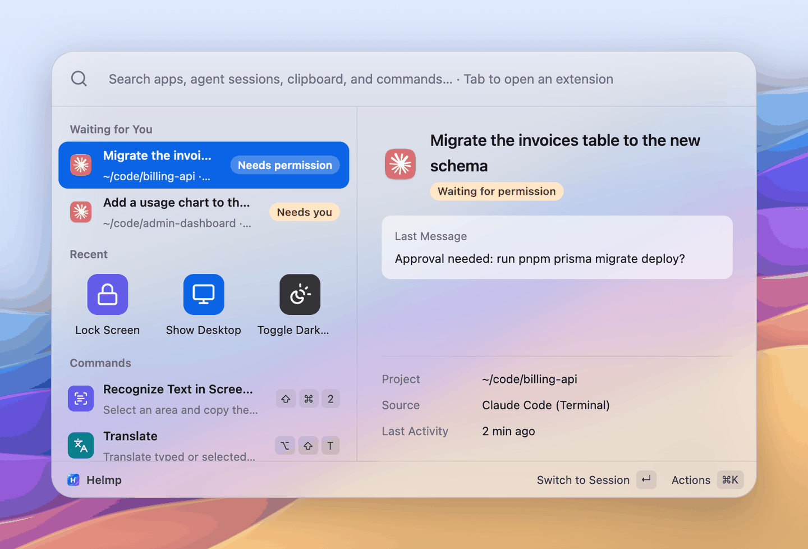
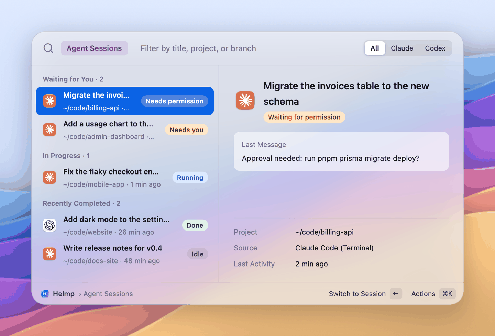
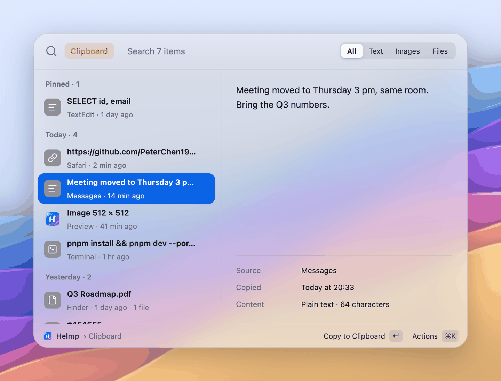
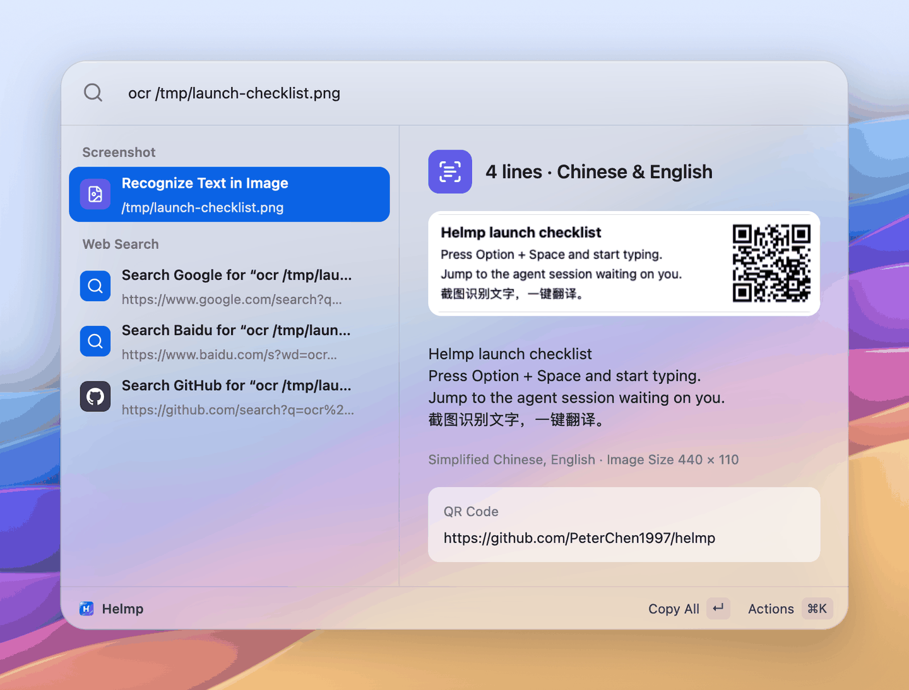
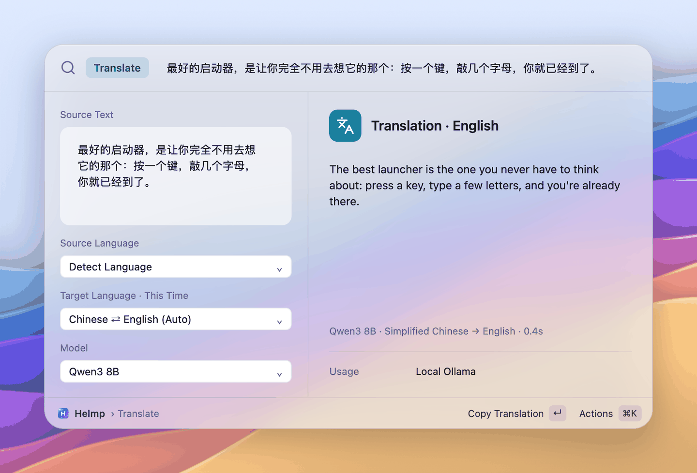

<p align="center">
  
</p>

<h1 align="center">Helmp</h1>

<p align="center">
  macOS 原生启动器，顺便告诉你哪个 coding agent 在等你。<br>
  用 Rust + <a href="https://www.gpui.rs">GPUI</a>（Zed 编辑器的 UI 框架）写的高性能原生应用，数据只在本机，不用登录，没有遥测。
</p>

<p align="center">
  <a href="README.md">English</a> · 简体中文
</p>

---

Helmp（读作 help me）是一个 Spotlight 式的 macOS 启动器：按 <kbd>⌥ Space</kbd>，输入，回车。除了打开应用，它还会列出你的 Claude Code 和 Codex 会话，一键跳到正在等你的那个；它有本地剪贴板历史，能识别截图里的文字和二维码，用你自己接入的模型翻译，能搜文件和浏览器书签，顺手算个数、换算单位和汇率，粘贴文本片段，摆放窗口，执行系统命令和开发者小工具，还能直接运行现成的 Raycast Script Commands 脚本和声明式插件。界面支持简体中文和英文。

> **当前状态：早期。** Helmp 还在积极开发中。签名并经过 Apple 公证的安装包可以在 [GitHub Releases](https://github.com/PeterChen1997/helmp/releases/latest) 下载，也可以从源码构建。

<p align="center">
  
</p>

| Agent 会话 | 剪贴板历史 |
|---|---|
|  |  |
| **截图识别** | **翻译** |
|  |  |

## 用 GPUI 写的原生应用

- [GPUI](https://www.gpui.rs) 是 Zed 编辑器自研的 Rust UI 框架。Helmp 的界面直接用 Metal 在 GPU 上绘制，没有 Electron，也没有 WebView。
- 安装包约 14 MB，常驻内存约 60 MB（0.4.1 在 macOS 27 上实测）。
- 目前只支持 macOS 15 及以上。GPUI 本身支持 macOS、Windows 和 Linux，界面部分理论上可以移植；但全局快捷键、截图与 OCR（Vision）、钥匙串、登录项这些系统集成用的是 macOS 专属接口，约占四分之一的源码，移植到其他平台需要逐一重写。

## 功能

大多数模块也能用「前缀 + 空格」直接进入（`f `、`bm `、`dev `……），写在下面各项里。每个扩展都可以在「设置 › 扩展」里加自己的别名。

### 搜索

- **应用搜索，支持拼音。** 英文名、中文本地化名、全拼、首字母都能搜：`wx`、`weixin`、`微信` 都能找到微信。多音字的各个读音都算数，按常用读音命中的排在按生僻读音命中的前面。详情里会写明这次是怎么匹配上的。<kbd>⌘K</kbd> 可以在访达中显示、复制路径，应用在运行时还能直接退出。索引覆盖 `/Applications`、`/System/Applications` 和 `~/Applications`，装卸应用后自动更新。
- **Agent 会话切换（Claude Code / Codex）**（`ag ` / `agent `，<kbd>⌃⌥A</kbd>）。命令行和桌面 App 里的会话都会列出来，依次显示「等你处理」「最近完成」「进行中」，详情用 Markdown 显示最后一条回复。未读的完成会话前有圆点；离开详情后，它会移到未读项下方，新一轮完成时再回到未读项中。可用「全部标为已读」清除当前列表里完成会话的未读圆点。Codex 写入本地数据库的已读回执也会自动同步。回车直接跳过去：桌面 App 走深链，iTerm2 和终端 App 精确选中对应的标签页，其他终端则激活宿主 App。正在运行的会话绝不会被再恢复一次。Helmp 对 `~/.claude`、`~/.codex` 只读，不写入，也不装任何 hooks。
- **文件与最近文件**（`f ` / `file ` / `文件 `）。用 Spotlight 搜文件名；不输入时列出最近 30 天用过的文件，这些文件还能用拼音首字母搜（`cesbg` → 测试报告.pdf）。全局搜索里也会混入少量文件结果。回车打开，<kbd>⌘↵</kbd> 在访达中显示，<kbd>⇧⌘C</kbd> 复制路径。搜索范围、排除的目录、要不要在全局搜索里显示文件，都在「设置 › 扩展 › 文件搜索」里。
- **浏览器书签**（`bm ` / `书签 `）。读取 Chrome、Edge、Brave、Arc（每个 profile）和 Safari 的书签，按标题（含拼音）或网址搜；输入两个字以上时，全局搜索里也会出现，排在应用后面。回车用书签所在的浏览器打开，<kbd>⌘↵</kbd> 用默认浏览器，<kbd>⇧⌘C</kbd> 复制链接。读 Safari 书签需要「完全磁盘访问」权限；没有权限时 Helmp 会说明，并给出打开对应设置页的入口。
- **系统设置面板。** 输入面板名（`bluetooth`、`蓝牙`、`ly`）直接打开系统设置的那一页，「隐私与安全性」下的辅助功能、录屏、完全磁盘访问等子页也能直达。
- **词典**（`define ` / `dict ` / `d ` / `词典 ` / `查 `）。用 macOS 自带词典离线查词。回车复制释义，<kbd>⌘↵</kbd> 在「词典」App 里打开，<kbd>⌘T</kbd> 把这个词送去翻译。系统词典要第一次打开「词典」App 后才会下载，在那之前 Helmp 会明确告诉你没有找到释义。
- **网页搜索兜底。** 只要输入不为空，结果列表末尾就会有「在 Google / 百度 / GitHub 搜索……」，回车用默认浏览器打开。必应和必应翻译也内置了，默认关闭；在「设置 › 扩展」里可以开关、调整顺序，也能添加自己的网址模板（`{query}` 会被替换成搜索词）。

### 效率

- **剪贴板历史**（`cb ` / `clip ` / `剪贴板 `，<kbd>⇧⌘V</kbd>）。本机保存文本、图片和文件路径，按天分组，可按类型筛选。已保存的内容超过 50 MB 时，从 72 小时前最旧的未置顶条目开始清理。单次复制超过 50 MB 时只记录时间、类型和大小到日志。密码管理器标记为「隐藏」的内容不会记录，也可以排除指定的 App（默认排除「密码」）。打开时默认选中最近的一条（置顶的仍列在最前）。回车或双击粘贴回你刚才所在的 App，<kbd>⌥↵</kbd> 粘贴为纯文本，<kbd>esc</kbd> 直接收起面板，不退回主搜索。⌘K 里可以置顶（置顶的排在最前、不受保留天数清理），或把从这条到最新的几条按复制顺序合并粘贴。
- **文本片段**（`sn ` / `片段 `）。常用文字存成片段，按名字、关键词或正文搜（支持拼音），回车粘贴到正在用的 App。支持 `{date}`、`{time}`、`{clipboard}`、`{uuid}`、`{cursor}`、`{argument name="…"}`（粘贴前出表单）等占位符；可在启动器里「新建片段」，在「设置 › 片段」里管理，也能导入 Raycast 和 Alfred 的片段。输入关键词自动展开暂不支持。
- **截图、钉图与识别文字**（「截图」<kbd>⇧⌘1</kbd> /「截图识别文字」<kbd>⇧⌘2</kbd>，两条独立的快捷键）。和 Snipaste 一样先冻结屏幕，再在静止的画面上框选（或单击选中窗口），选区可以继续调整，然后保存、复制、钉在屏幕上（置顶的浮动图片）或识别文字。「截图识别文字」松开鼠标就用 Apple Vision 识别，结果显示在选区旁边。识别结果保留换行和分段：回车复制全部，<kbd>⇧⌘C</kbd> 复制为单行，<kbd>⌥⌘C</kbd> 去掉换行后复制，<kbd>⌘T</kbd> 带进翻译。图里有二维码或条码时也会列出内容，是链接的可以直接打开。识别语言默认简体中文和英文，可以在「设置 › 截图」里加上繁体中文、日语、韩语、法语、德语、西班牙语、意大利语、葡萄牙语、俄语。也能识别剪贴板里的图片，或指定的图片文件（`ocr /图片/路径.png`）。
- **翻译，用你自己的模型**（`fy ` / `tr ` / `翻译 `，<kbd>⌥⇧T</kbd>）。支持 Anthropic、任意 OpenAI 兼容接口（OpenAI、DeepSeek、各类网关）和本机 Ollama，API Key 存在 macOS 钥匙串里。输入停顿片刻就自动翻译，源语言自动识别，目标语言默认「中文译成英文，其他译成中文」，也可以只针对这一次换目标语言或模型。打开翻译时会自动带上前台 App 里选中的文字，光标直接落在输入框里。回车复制译文，<kbd>⌘↵</kbd> 用译文替换原来的选中内容，<kbd>⇧⌘C</kbd> 复制原文，<kbd>⌘R</kbd> 用系统语音朗读译文。输入框为空时按 <kbd>↑</kbd> 可以翻出最近翻译过的原文，同样的原文直接显示上次的结果，不会再调一次模型。这份历史只放在内存里。
- **计算器、单位与汇率。** 输入算式，答案直接排在第一条：支持 `+ - * / % ^ **`、括号，`sqrt`、`sin`、`ln`、`log`、`pow`、`min`、`max` 等函数，以及 `pi`、`e`。全角符号、中文括号、`×` `÷` 也认。单位和货币换算也一样直接出答案：`10 km to mi`、`3斤`、`100 usd to cny`。汇率用欧洲央行（ECB）每日参考汇率，缓存在本机，离线也能换算（副标题写明汇率更新于哪天）；输入 `汇率` / `exchange rate` 列出常用币对。回车复制结果。`wx`、`2026` 这类普通搜索词不会被当成算式。
- **时间、时区与时间戳。** `now`、`time tokyo` / `东京时间`、秒或毫秒的 Unix 时间戳（`1731234567`）、`2026-11-10 10:00 pst to beijing`、`3pm 北京 in 纽约`、`in 3 days` / `3天后`、`next friday`。每一行是一种写法（本地时间、UTC、ISO 8601、Unix 秒 / 毫秒、目标时区），回车复制这一行。时区规则内置，全程离线。
- **Emoji 与符号**（`emoji ` / `表情 ` / `符号 `）。按中英文名称和关键词搜 emoji 和常用符号（箭头、数学、货币、⌘⌥⇧……），中文名也能用拼音搜（`xiao` → 笑）。全局搜索里以 `:` 开头（`:xiao`）只搜 emoji。回车粘贴到前台 App，<kbd>⌘C</kbd> 只复制；⌘K 里可以复制码点、选肤色。最近用过的排在最前。

### 开发者

- **开发工具**（`dev ` / `开发 `）。UUID、密码、哈希（MD5、SHA-1、SHA-256……）、Base64、URL 编解码、JSON 格式化与校验、命名风格转换（驼峰、下划线、短横线……）、进制转换、JWT 解码（不校验签名）、假文，以及本机和公网 IP。全局搜索里以工具名开头（`uuid`、`md5 hello`、`json {...}`、`pwd 24`），或者直接粘贴一眼就能认出的内容（`0xff`、JWT、JSON 对象）就会出结果。在范围里输入任意文字，会列出它的各种哈希、编码和命名写法。回车复制这一行。公网 IP 只在你对那一行按回车时才去查。
- **进程与端口**（`kill ` / `进程 ` / `ps `）。按 CPU 列出你的进程并按名字搜（支持拼音）；回车退出，<kbd>⌘↵</kbd> 强制退出（先确认），<kbd>⌘C</kbd> 复制 PID。`port 3000` / `端口 3000` / `:3000` 直接把占用端口的进程排到第一条。系统关键进程连普通退出也要先确认，Helmp 也不会结束它自己。
- **取色器与颜色转换。** 「取色」（`Pick Color`）调起 macOS 的取色放大镜，取到的颜色以 HEX、RGB、HSL、OKLCH、SwiftUI、NSColor 各种写法列出；回车复制 HEX，⌘K 复制其他写法。直接输入 `#ff8800`、`rgb(255, 136, 0)`、`hsl(32, 100%, 50%)` 也会这样换算，带色块预览。

### 系统

- **窗口管理。** 18 条命令，作用于唤起 Helmp 之前的窗口：左 / 右 / 上 / 下半屏、四角、三分之一、三分之二、最大化、几乎最大化、居中、恢复原位、移到下一个显示器。按名字或拼音搜（`zbp` 就是左半屏）。需要辅助功能权限；没有权限时命令照样列出，回车告诉你怎么授权。
- **系统命令。** 锁屏、睡眠、清空废纸篓、显示桌面、隐藏其他应用、切换深色模式、重启、关机、注销、打开系统设置、退出所有应用，中英文名和拼音都能搜到。无法撤销的命令（清空废纸篓、重启、关机、注销、退出所有应用）会先显示确认页：回车执行，<kbd>esc</kbd> 取消。确认可以在「设置 › 扩展」里关掉。
- **系统开关。** 防休眠（`防休眠`、`caffeinate`；`防休眠 2h` / `caffeinate 30m` 到时自动关闭，Helmp 退出时也一起停止）、设置音量（`音量 30` / `vol 30`）、静音与取消静音、在访达里显示或隐藏隐藏文件、弹出所有磁盘。显示隐藏文件会重启访达、弹出磁盘会打断进行中的拷贝，所以这两条和系统命令一样先确认。
- **菜单栏。** 没有 Dock 图标。有会话在等你时，菜单栏图标右上角会出现一个橙点；菜单里列出这些会话、常用入口、设置和退出。
- **全局快捷键，录制时就查冲突。** 一个唤起面板，每个模块再各有一个，都能在设置里改或关掉。录制新组合时，Helmp 会当场检查它是否和 Helmp 自己的其他命令、系统「键盘快捷键」里已启用的项、macOS 固定占用的组合（如 <kbd>⌘Tab</kbd>）、各 App 通用的菜单快捷键（<kbd>⌘Q</kbd>、<kbd>⌘C</kbd>……）或其他 App 已注册的快捷键撞车。有冲突就不保存，并说明是被谁占用了。已保存的快捷键之后如果注册失败，设置里对应那一行会写明原因。
- **中英双语界面。** 默认跟随系统语言，可以在「设置 › 通用 › 语言」里切换，不用重启。两种语言下搜索行为一致：中文名和拼音始终能搜到。

### 集成与插件

- **插件。** 一个文件夹加一份声明式的 `plugin.json`：命令可以打开网址或 URL scheme、发 HTTP 请求、运行脚本、复制或粘贴；支持表单、偏好设置（密钥只存在钥匙串里），还有由脚本输出 Alfred Script Filter JSON 的动态列表。不用写代码。自带 flomo、快捷搜索（`gh`、`npm`、`crates`、`mdn`、`gt`、`zhihu`、`bili`、`xhs`）和 Obsidian 快速记录。你自己的插件在启用前会先列出它能做什么。见[插件](#插件)。
- **兼容 Raycast 的脚本命令。** 带 `@raycast.*` 头注释的脚本放进脚本目录就会变成一条命令。语言不限，最多三个参数（自动生成表单），支持 `silent` / `compact` / `fullOutput` 三种输出方式，标了 `needsConfirmation` 的脚本运行前会先显示确认页，每次运行最多 30 秒。
- **MCP 服务器。** 连上 [Model Context Protocol](https://modelcontextprotocol.io) 服务器，它们的工具就变成命令，参数表单按工具的输入 schema 自动生成。可以从 Claude Code、Codex、Cursor 一键导入，从精选（文件系统、抓网页、Git、Playwright、Context7…）里添加，或者粘贴 JSON。见 [MCP 服务器](#mcp-服务器)。
- **`helmp://` 深链接。** 从脚本、快捷指令或别的启动器里唤起面板并带上查询、直接进入某个扩展、运行插件命令、打开某一页设置。见 [docs/deeplinks.md](docs/deeplinks.md)。
- **Coding agent（MCP）。** 连接 Claude Code、Codex 或 Cursor 后，直接跟它说你想要的 Helmp 功能：它做成插件、测好、装上，由你启用。它也能搜索和使用 Helmp，有副作用的操作先在面板里问你。见 [Coding agent](#coding-agentmcp)。

一些让日常使用更顺手的细节：

- 90 秒内再次唤起会保留上次的输入并全选；超过 90 秒，或者刚执行过一个结果，就从空白开始。
- 设置窗口（通用、扩展、插件、MCP、模型、Agent、剪贴板、片段、截图、外观、关于）和首次启动的权限引导。
- 无头命令行（`helmp query wx`、`helmp plugins`），方便写脚本和排查问题。

## 安装

Helmp 需要 macOS 15 Sequoia 或更新版本。

### 下载安装包

1. 从[最新发布](https://github.com/PeterChen1997/helmp/releases/latest)下载 `Helmp-<版本>.dmg`。安装包用 Developer ID 签名，并经过 Apple 公证。同一个 App 的 `.zip` 和 `SHA256SUMS.txt` 也在里面。
2. 打开 dmg，把 Helmp 拖进「应用程序」。
3. 从「应用程序」里启动 Helmp，首次启动的引导会带你授权（见下文）。

Helmp 每天检查一次更新（可在「设置 › 通用」里关掉），只有你在「设置 › 关于」里点「下载并安装」后，才会在校验签名后安装。见 [docs/updates.zh-CN.md](docs/updates.zh-CN.md)。

如果之前用过自己构建的（ad-hoc 签名）Helmp，签名版可能读不到旧版本存在钥匙串里的 API Key。遇到这种情况 Helmp 会直接说明，在「设置 › 模型」里重新保存一次 Key 就好。系统按签名记录权限，所以也可能需要重新授权一次。

### 从源码构建

需要：

- 用 [rustup](https://rustup.rs) 管理的 Rust 工具链。具体版本锁在 [`rust-toolchain.toml`](rust-toolchain.toml) 里，第一次构建时会自动安装。
- Xcode。GPUI 用 `xcrun metal` 编译 Metal 着色器；如果提示找不到这个命令，运行 `xcodebuild -downloadComponent MetalToolchain`。

```bash
git clone https://github.com/PeterChen1997/helmp.git
cd helmp

# 直接运行（开发时）
cargo run

# 构建 release 版本
cargo build --release

# 打包成 target/release/Helmp.app 并签名
bash script/bundle.sh release
open target/release/Helmp.app
```

`script/bundle.sh` 的签名顺序：先用 `HELMP_SIGN_IDENTITY` 指定的证书，没有就找本机第一个「Developer ID Application」或「Apple Development」证书，都没有才退回 ad-hoc 签名。系统按签名记录权限，用 ad-hoc 签名的话，每次重新打包都要重新授权。`helmp://` 链接协议是打包后的 App 注册的，所以深链接要用 `Helmp.app`，`cargo run` 起来的进程收不到。签名、公证的发布包由维护者用 `script/release.sh` 打，见 [CONTRIBUTING.md](CONTRIBUTING.md#简体中文)。

## 首次启动与权限

第一次启动会出现一个简短的引导。点某项权限旁边的按钮，再把浮窗里的 Helmp 图标拖进系统设置的列表即可。

| 权限 | 用途 | 不授权时 |
|---|---|---|
| 辅助功能 | 把剪贴板条目粘贴到前台 App、翻译时读取选中的文字、用译文替换选中内容；「锁屏」也靠它代按 <kbd>⌃⌘Q</kbd> | 内容仍会写进剪贴板，需要你自己按 <kbd>⌘V</kbd>；翻译打开时输入框是空的 |
| 录屏 | 区域截图、截图识别文字 | 截图命令会停下并提供「前往授权」；识别剪贴板图片和图片文件不受影响 |
| 自动化（首次使用时由系统询问） | 跳转 Agent 会话时选中 iTerm2 / 终端里对应的标签页；部分系统命令（锁屏、切换深色模式、重启、关机、注销、清空废纸篓）要控制「System Events」或访达 | 这些操作会失败并给出提示；桌面 App 里的会话走深链，不受影响 |

全局快捷键用的是 Carbon 的 `RegisterEventHotKey`，不需要任何权限。

## 快捷键

全局快捷键（默认值；第一个在「设置 › 通用」里改，其余在「设置 › 扩展」里改；两条截图快捷键在「设置 › 截图」里也并排列着）：

| 快捷键 | 作用 |
|---|---|
| <kbd>⌥ Space</kbd> | 唤起 / 收起面板 |
| <kbd>⇧⌘V</kbd> | 剪贴板历史 |
| <kbd>⇧⌘1</kbd> | 截图：冻结屏幕后框选，再复制 / 保存 / 钉图 |
| <kbd>⇧⌘2</kbd> | 截图识别文字：框选屏幕上的一块并识别文字（不打开面板，直接执行） |
| <kbd>⌥⇧T</kbd> | 翻译（自动带上选中的文字） |
| <kbd>⌃⌥A</kbd> | Agent 会话 |

翻译和 Agent 的默认快捷键特意避开了 <kbd>⇧⌘T</kbd>（浏览器的「重新打开标签页」）和 <kbd>⌥A</kbd>（会输入字符 `å`）。

面板内：

| 快捷键 | 作用 |
|---|---|
| <kbd>↑</kbd> <kbd>↓</kbd> | 选择（在翻译里，输入框为空时 <kbd>↑</kbd> 翻出最近的原文） |
| <kbd>↵</kbd> | 执行主操作 |
| <kbd>⌘K</kbd> | 当前项的更多操作 |
| <kbd>⇥</kbd> | 在首页或搜索结果里：进入选中项所属的扩展；在扩展里：切换筛选（如 全部 / 文本 / 图片 / 文件） |
| <kbd>esc</kbd> | 依次：关闭操作菜单 → 关闭结果或确认页 → 退出扩展 → 收起面板。在剪贴板里直接收起面板 |
| <kbd>⌫</kbd> | 在扩展里、输入框为空时：退出扩展 |
| <kbd>⌘,</kbd> | 打开设置 |

输入前缀加空格可以直接进入某个模块：`ag ` / `agent ` 进 Agent 会话，`cb ` / `clip ` / `剪贴板 ` / `剪切板 ` 进剪贴板，`fy ` / `tr ` / `翻译 ` 进翻译，`f ` 进文件，`bm ` 进书签，`sn ` 进片段，`dev ` 进开发工具，`kill ` 进进程，`表情 ` 进 Emoji，`查 ` / `define ` 进词典。各模块的全部前缀见上面的功能说明。在「设置 › 扩展」里还能给每个扩展加自己的别名。

## 深链接

Helmp 注册了 `helmp://` 链接协议：

```bash
open "helmp://show?q=wx"                      # 唤起面板并带上查询
open "helmp://scope/translate?q=hello%20world" # 进入扩展：translate、clipboard、agents
open "helmp://settings/extensions"            # 打开设置的某一页
open "helmp://hide"                           # 收起面板
```

完整说明见 [docs/deeplinks.md](docs/deeplinks.md)。

## 配置与数据位置

Helmp 保存的所有东西都在同一个目录里：

```
~/Library/Application Support/Helmp/
├── config.json          设置，含网页搜索引擎（不含任何密钥）
├── history.json         首页「最近使用」，最多 30 条
├── clipboard.sqlite     剪贴板历史
├── clipboard-images/    复制过的图片
├── snippets.json        你的文本片段
├── scripts/             你的脚本命令（默认脚本目录）
├── plugins/             你的插件，每个一个文件夹
├── screenshots/         截图另存为面板的默认目录（可改）
├── ocr/                 识别结果里展示的最近几张截图
├── fx.json              缓存的 ECB 汇率
├── emoji-recent.json    最近用过的 emoji
├── colors/              颜色色块
└── icon-cache/          渲染好的应用与文件图标
```

`config.json` 由设置窗口读写；要手动改的话，请先退出 Helmp。API Key 存在钥匙串里，不在这个文件中。设置环境变量 `HELMP_DATA_DIR` 可以换一个目录（测试时很方便）。具体存了什么、读了什么，见 [docs/privacy.zh-CN.md](docs/privacy.zh-CN.md)。

## 脚本命令

Helmp 兼容 [Raycast Script Commands](https://github.com/raycast/script-commands) 的头注释格式。把可执行脚本放进 `~/Library/Application Support/Helmp/scripts/`（或者在「设置 › 扩展」里添加别的目录），几秒内就会出现在搜索结果里：

```bash
#!/bin/bash

# @raycast.schemaVersion 1
# @raycast.title 当前时间
# @raycast.mode compact
# @raycast.packageName 示例
# @raycast.description 显示当前日期与时间

date "+%Y-%m-%d %H:%M:%S %Z"
```

声明参数后会自动生成表单：

```bash
# @raycast.argument1 { "type": "text", "placeholder": "关键词" }
# @raycast.argument2 { "type": "dropdown", "placeholder": "引擎", "data": [{"title": "Google", "value": "g"}, {"title": "Bing", "value": "b"}] }
```

更多例子见 [`examples/scripts`](examples/scripts)，完整的字段说明见 [docs/scripts.zh-CN.md](docs/scripts.zh-CN.md)。

## 插件

插件就是一个带声明式 `plugin.json` 的文件夹：表单、偏好设置（密钥只进钥匙串）、HTTP 请求、URL Scheme、脚本驱动的列表，不用写代码。自带 flomo、Obsidian 快速记录和「快捷搜索」（`gh`、`npm`、`crates`、`mdn`、`gt`、`zhihu`、`bili`、`xhs`）。在「设置 › 插件」里管理；你自己的插件放在 `~/Library/Application Support/Helmp/plugins/`，看过权限并启用后才生效。插件更新后如果要更多权限（多一个主机、要运行脚本），会自动停用，等你再确认一次。

- **设置 › 插件**：启用 / 停用插件、填偏好设置，还有「打开插件文件夹」「重新加载」「新建插件」（生成一个能直接用的模板）和「开发者文档」几个按钮。加载失败的插件会留在列表里并写明原因。
- **`helmp plugins`** 列出插件及其状态；**`helmp plugins validate <目录>`** 一次列出正在写的插件的全部问题。
- **接受输入的命令**（flomo、`gh`、`npm`…）在全局搜索里只列出来，不接收你在那里打的字，日常搜索不会误触发插件：在它上面按 <kbd>Tab</kbd> 进入（搜索栏里出现插件名标签），再输入、回车；<kbd>Esc</kbd> 返回。
- **`helmp://plugin/<插件 id>/<命令 id>?q=…`** 从链接调用某个命令。只打开链接的命令直接执行；接受输入的命令打开时已填好 `q`；带表单、会发请求、运行脚本或读写剪贴板的命令，要等你按回车才执行。

自己写插件：教程与清单字段参考见 [docs/plugins.zh-CN.md](docs/plugins.zh-CN.md)，[docs/plugin-schema.json](docs/plugin-schema.json) 是给编辑器补全用的 JSON Schema。[`resources/plugins/`](resources/plugins) 里的自带插件也可以当例子看。

## Coding agent（MCP）

`helmp mcp` 是给 coding agent 用的 MCP 服务。在 **设置 › Agent › 连接到 coding agent** 里连接（或 `helmp mcp install claude|codex|cursor`），重启 agent，然后告诉它你想要什么（「帮我做一个把选中文字发到飞书机器人的插件」）。agent 读插件指南、生成模板、校验、对着本地假服务演练测试、安装；插件保持停用，等你在「设置 › 插件」里看过权限后打开；上传到插件中心前 agent 必须先问你。agent 也能搜索 Helmp、执行结果：纯计算（计算器、换算、时间、开发者工具、词典、翻译）直接返回文字；其余操作都在面板里显示「Claude Code 想执行：…」，你按回车才执行。剪贴板历史和 Agent 会话默认不给 agent 看。见 [docs/mcp.zh-CN.md](docs/mcp.zh-CN.md)。

## MCP 服务器

「设置 › MCP」管理 [Model Context Protocol](https://modelcontextprotocol.io) 服务器，它们提供的每个工具都变成启动器命令（输入工具名，按 <kbd>Tab</kbd>，填表单，回车）。添加方式：从 Claude Code、Codex、Cursor 只读导入；从内置的「精选」里添加（先给你看要运行的完整命令）；粘贴常见的 `{"mcpServers": {...}}` JSON；或者手动填写。服务器第一次用到才启动，空闲 10 分钟后停止，崩溃后退避重启，日志在数据目录的 `mcp/logs/` 里。令牌和 Key 存进钥匙串。标了破坏性的工具运行前会先确认。插件也可以自带服务器。终端里用 `helmp mcp-client list|add|remove|tools|import`。详见 [docs/mcp-client.zh-CN.md](docs/mcp-client.zh-CN.md)。

## 命令行

```bash
cargo run -- query wx            # 打印结果：分组、标题、副标题、id
cargo run -- run <id> [query]    # 执行某个结果
cargo run -- providers           # 列出已注册的 provider
cargo run -- plugins             # 列出清单插件及其状态
cargo run -- plugins validate <目录>   # 检查正在写的插件
cargo run -- mcp                 # 给 coding agent 用的 MCP 服务（stdio）
cargo run -- mcp install claude  # 登记到 Claude Code（或 codex、cursor）；`mcp status` 查看全部
cargo run -- mcp-client list     # MCP 服务器：状态、工具数、命令（还有 add / remove / tools / import）
HELMP_DRY_RUN=1 cargo run -- run <id> agent   # 只打印 Agent 跳转命令，不执行
HELMP_TRACE=1 cargo run          # 把界面事件打到 stderr
```

## 测试

```bash
cargo test --release
```

这条命令会跑单元测试和端到端测试（`tests/e2e_*.rs`）。端到端测试用真实的 `helmp` 可执行文件，把每个功能的「查询 → 执行」走一遍：应用搜索、计算器、单位与汇率、时间、开发工具、Emoji、颜色、文件、系统设置面板、系统开关、书签、词典、窗口管理、进程与端口、片段、剪贴板、翻译、OCR、脚本命令、插件、MCP 服务器（对着 `examples/mock_mcp_server.rs` 编译出的假服务器）、Agent 会话和自动更新。每个用例都有自己的临时数据目录和 `HOME`，并以 `HELMP_DRY_RUN=1` 运行，复制、粘贴、打开网址、移动窗口、结束进程都只回报不执行（只有一个用例真的结束了它自己起的 `sleep` 进程）。测试不会读写你的剪贴板和钥匙串，不碰 `~/.claude`、`~/.codex`，也不会访问真实网络：HTTP 请求都发往本机的假服务。少数依赖本机环境的用例（比如要求 Spotlight 已经给仓库建好索引）标了 `#[ignore]`，用 `-- --ignored` 运行。怎么新增用例见 [CONTRIBUTING.md](CONTRIBUTING.md)。

## Roadmap

下面是想做但还没做的事，顺序可能调整。

- Homebrew cask。签名、公证的安装包已经在 GitHub Releases 上，Helmp 也能自己更新。
- 以 MCP server 的形式把应用搜索、剪贴板、截图、OCR 开放给 coding agent。
- 支持 Claude Code、Codex 之外的更多 agent。
- 脚本命令：Alfred Script Filter JSON 输出、自定义图标、带 `refreshTime` 的实时 `inline` 模式（这两个字段现在能解析，但还没用上）。
- 常驻插件（有自己的视图）和隔离的插件运行环境。

## 参与贡献

欢迎提 issue 和 PR。动手之前请先看 [CONTRIBUTING.md](CONTRIBUTING.md)；[docs/architecture.md](docs/architecture.md)（英文）讲了各模块是怎么接进来的。

## 请我喝杯果茶

如果 Helmp 帮到了你，想请我喝杯果茶，欢迎扫码～

<p align="center">
  
</p>

## 协议

[MIT](LICENSE) © 2026 Peter Chen
